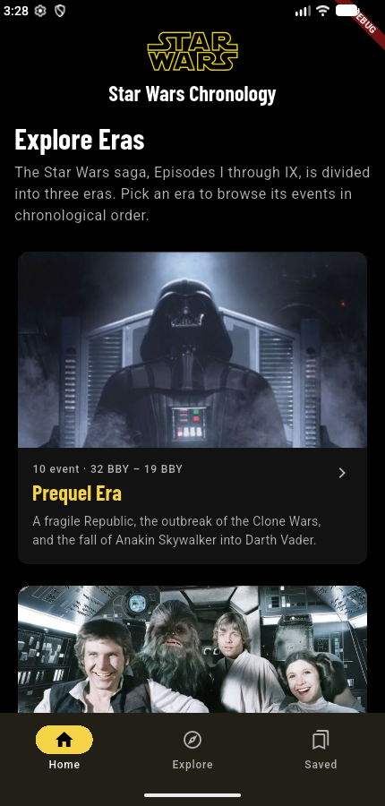
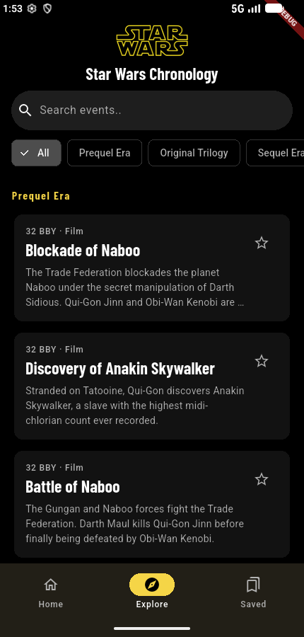
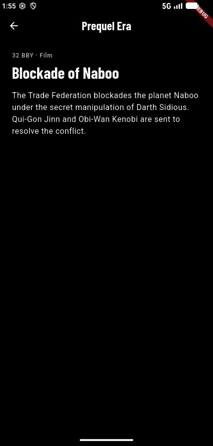
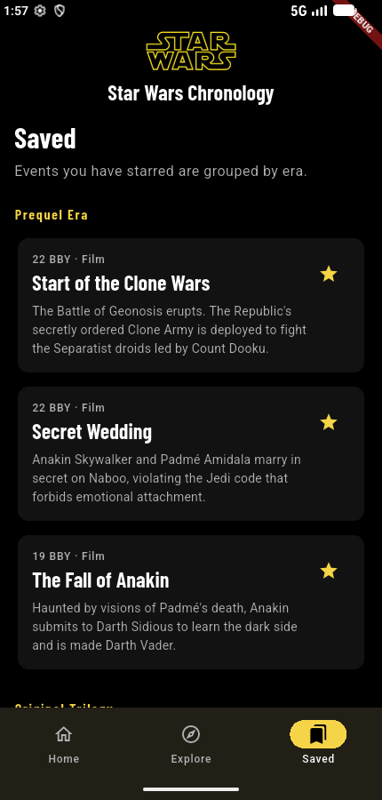
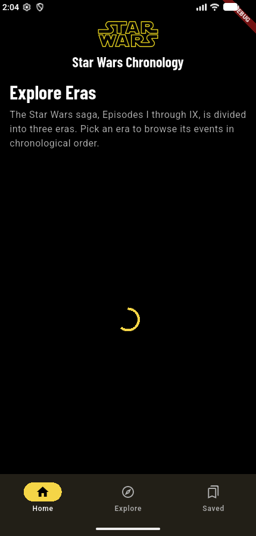
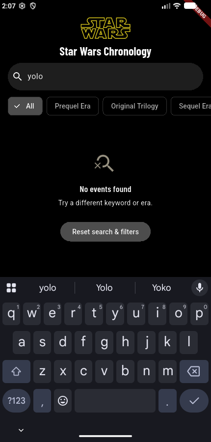
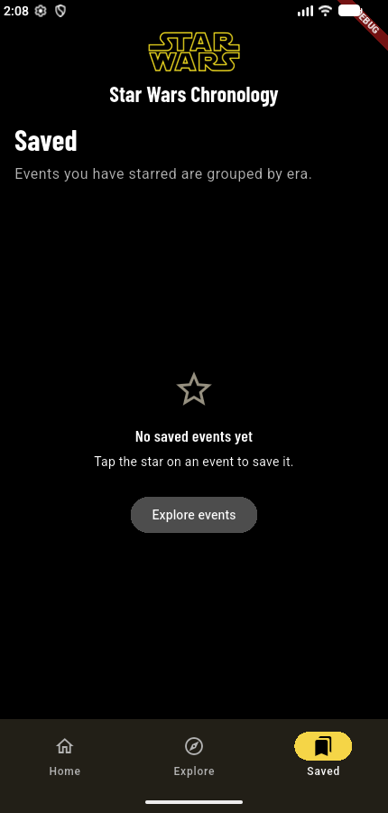
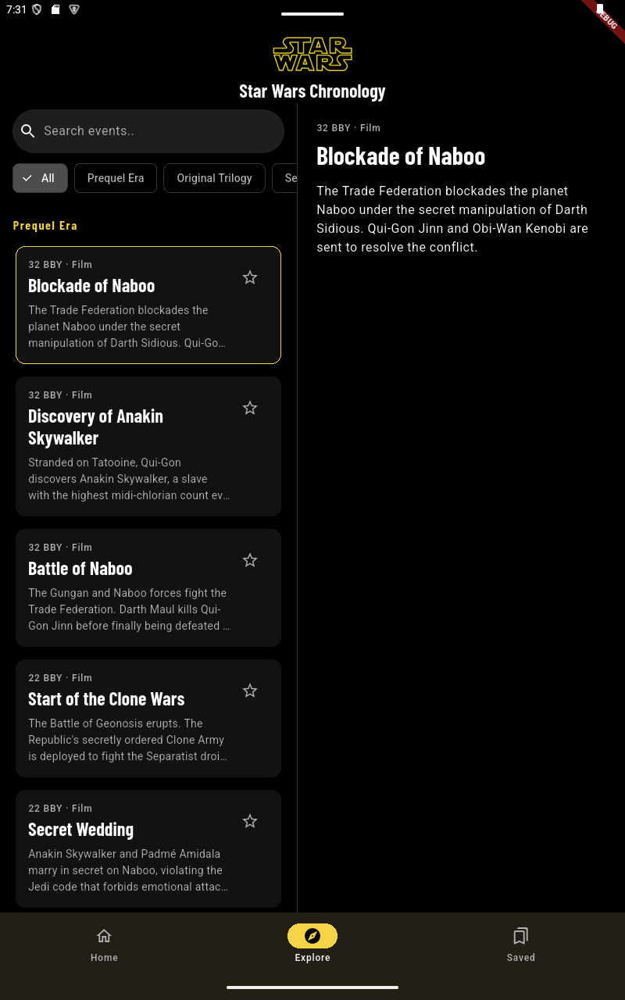
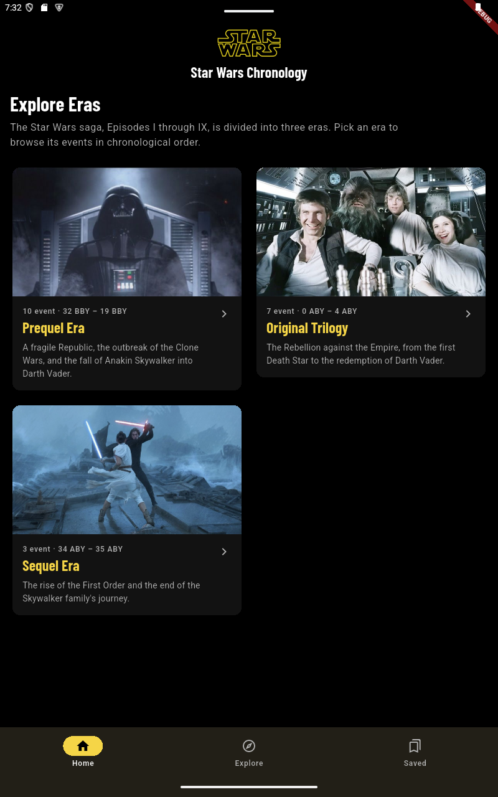
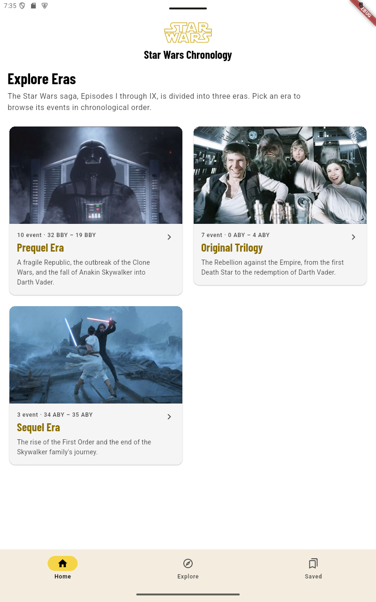

# Star Wars Chronology

Panduan kronologi film Star Wars Episode I-IX berdasarkan era, dibuat dengan Flutter dan Material Design 3.

> Tugas AFL 1, mata kuliah Visual Programming.

## Studi Kasus

**Track B: The Lore & Discovery Hub (Franchise Chronology Explorer).**

Saga Star Wars punya banyak peristiwa yang tersebar di tiga era, sehingga penggemar baru sering bingung harus mulai dari mana. Aplikasi ini membantu pengguna menelusuri peristiwa Star Wars (khusus film Episode I-IX) secara berurutan, mencari peristiwa tertentu, dan menyimpan peristiwa favorit.

Aplikasi dirancang untuk dipakai saat menonton di ruangan redup, jadi tema gelap memakai latar hitam penuh dengan teks putih berkontras tinggi. Warna kuning ikonik Star Wars (`#F5D547`) dipakai terbatas sebagai aksen. Tema terang juga tersedia dengan aksen emas gelap (`#8A6D00`) agar tetap terbaca di latar putih.

## Fitur

- **Home (Jelajahi Era):** kartu tiga era (Prequel, Original Trilogy, Sequel) lengkap dengan gambar, jumlah peristiwa, dan rentang tahun. Ketuk kartu untuk membuka daftar peristiwa era tersebut.
- **Explore (Linimasa):** daftar peristiwa yang dikelompokkan per era, dengan pencarian berdasarkan judul atau ringkasan dan filter era lewat chip.
- **Detail peristiwa:** tahun (BBY/ABY), jenis media, judul, dan ringkasan lengkap.
- **Saved (Tersimpan):** kumpulan peristiwa yang dibintangi, dikelompokkan per era.
- **Favorit:** tombol bintang di setiap kartu, state dibagikan ke semua layar.
- **Layout adaptif:**
    - Lebar di bawah 720 dp: `NavigationBar` di bawah.
    - Lebar 720 dp ke atas: `NavigationRail` di samping.
    - Lebar 700 dp ke atas pada layar Explore: dua panel (daftar di kiri, detail di kanan).
    - Tinggi di bawah 500 dp (landscape HP): AppBar ringkas tanpa logo.
- **State lengkap:** loading, terisi, dan kosong (pencarian tidak ditemukan atau belum ada favorit), lengkap dengan tombol aksi.
- **Dark mode dan light mode** mengikuti pengaturan sistem.
- **Font offline:** Barlow Condensed dibundel di `assets/google_fonts/`, jadi tampilan tetap sama tanpa internet.

## Screenshot

### HP

| Home                                      | Explore                                         | Detail                                        | Saved                                       |
|-------------------------------------------|-------------------------------------------------|-----------------------------------------------|---------------------------------------------|
|  |  |  |  |
### State khusus

| Loading                                         | Empty (pencarian)                                         | Empty (Saved)                                           |
|-------------------------------------------------|-----------------------------------------------------------|---------------------------------------------------------|
|  |  |  |

### Tablet dan Tema

| Tablet (dua panel)                            | Dark mode                                 | Light mode                                  |
|-----------------------------------------------|-------------------------------------------|---------------------------------------------|
|  |  |  |

### Rekaman layar

[Tonton demo](docs/week05/videos/Video-Documentation.webm)

## Unduh APK

Unduh `app-release.apk` dari halaman [Releases](https://github.com/eangelina04-dev/VP-Star-Wars-Chronology-Elvina-Angelina-2086022510009/releases/download/v1.0.0/app-release.apk) lalu pasang di perangkat Android.
Mengecek halaman release di (https://github.com/eangelina04-dev/VP-Star-Wars-Chronology-Elvina-Angelina-2086022510009/releases/tag/v1.0.0)

## Cara Menjalankan

### Prasyarat

- Flutter SDK dengan Dart `^3.13.3` (sesuai `pubspec.yaml`)
- Android Studio atau VS Code dengan ekstensi Flutter
- Emulator, perangkat Android, atau Chrome

### Langkah

```bash
git clone LINK_REPO
cd star_wars_chronology
flutter pub get
flutter run
```

Jalankan di Chrome:

```bash
flutter run -d chrome
```

Jalankan dengan 500 data uji (untuk tes daftar panjang dan teks panjang):

```bash
flutter run -d chrome --dart-define=STRESS=true
```

### Test dan analisis

```bash
flutter analyze
flutter test
```

### Build APK

```bash
flutter build apk --release
```

Hasil: `build/app/outputs/flutter-apk/app-release.apk`

## Struktur Proyek

```
lib/
├── main.dart
├── app.dart
├── core/
│   ├── constants/
│   │   └── app_name.dart
│   ├── theme/
│   │   └── app_theme.dart
│   └── widgets/
│       └── brand_app_bar.dart
└── features/
    └── timeline/
        ├── data/
        │   └── timeline_data.dart
        ├── domain/
        │   ├── era.dart
        │   ├── timeline_entry.dart
        │   ├── timeline_filter.dart
        │   └── era_summary.dart
        └── presentation/
            ├── state/
            │   ├── favorites_controller.dart
            │   └── favorites_scope.dart
            ├── widgets/
            │   └── detail_placeholder.dart
            │   └── empty_results_view.dart
            │   └── era_card.dart
            │   └── era_filter_chips.dart
            │   └── era_grid.dart
            │   └── era_header.dart
            │   └── timeline_detail_body.dart
            │   └── timeline_entry_card.dart
            │   └── timeline_list.dart
            │   └── timeline_search_field.dart
            └── era_screen.dart
            └── home_shell.dart
            └── saved_screen.dart
            └── timeline_detail_screen.dart
            └── timeline_screen.dart
```

Penjelasan lengkap ada di [docs/structure.md](docs/week05/structure.md).

## Teknologi

- Flutter dan Material Design 3
- [`google_fonts`](https://pub.dev/packages/google_fonts) (Barlow Condensed, dibundel offline)
- State favorit: `ChangeNotifier` + `InheritedNotifier`

## Dokumentasi

- [Struktur proyek](docs/week05/structure.md)
- [Refleksi Week 05](docs/week05/reflection.md)

## Rencana Pengembangan (Versi 2)

- Gambar untuk setiap event di layar Detail (field `imageAsset` opsional pada `TimelineEntry`).
- Menyimpan favorites secara persisten (local storage).
- Memindahkan state ke solusi state management standar (Module 2).